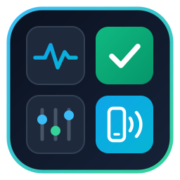

<div align="center">
  
  <h1>NexDeck</h1>
  <p><strong>Лёгкая открытая модульная платформа для мониторинга Windows 11, настраиваемых панелей управления в стиле Stream Deck, уведомлений и удалённого подтверждения действий с телефона.</strong></p>

  <p>
    <a href="https://github.com/NoVate911/NexDeck/actions/workflows/ci.yml"></a>
    <a href="https://github.com/NoVate911/NexDeck/actions/workflows/security.yml"></a>
    <a href="LICENSE"></a>
  </p>

  <p>
    <a href="docs/README.en.md">English</a> ·
    <a href="docs/architecture/overview.md">Архитектура</a> ·
    <a href="docs/architecture/roadmap.md">Дорожная карта</a> ·
    <a href="docs/api/universal-api.md">Universal API</a> ·
    <a href="JOURNAL.md">Журнал проекта</a>
  </p>
</div>

---

## О проекте

**NexDeck** превращает смартфон (Android / iOS) в персональную панель мониторинга и управления компьютером под Windows 11 без облачных серверов и тяжёлых фоновых процессов.

- **Минимальное потребление ресурсов:** фоновый агент на **Rust** без встроенного GUI, ориентир — **2–5 МБ RAM в простое**.
- **Независимость от транспорта:** в MVP используется Wi-Fi / WebSocket, архитектура абстрагирована для последующей поддержки USB и Bluetooth.
- **Модульность и безопасность:** чёткое разделение ядра, отдельного Desktop-конфигуратора, мобильного клиента, изолированных WASM-плагинов и системы подтверждения действий.

> **Статус:** завершён **Этап 0** (инфраструктура репозитория, контракты крейтов, документация, CI/CD и защита `main`). Впереди — **Этап 1 (Core Agent)**. Актуальный статус ведётся в [`JOURNAL.md`](JOURNAL.md).

---

## Ключевые возможности (по этапам)

| Подсистема | Назначение | Этап |
| --- | --- | --- |
| **Системный мониторинг** | CPU (по ядрам, частоты, температуры), RAM, GPU, диски, сеть, датчики, процессы, батарея | Этап 1–2 |
| **Конструктор панелей** | Несколько экранов, сетка виджетов, графики, кнопки, переключатели, импорт/экспорт | Этап 3 |
| **Удалённое управление** | Запуск программ, громкость, мультимедиа, горячие клавиши, разрешённые команды, питание | Этап 2–5 |
| **Universal API** | Локальный IPC, WebSocket и HTTP API + SDK для сторонних приложений | Этап 4 |
| **Remote Approval** | Запросы на подтверждение действий с телефона (таймаут, уровни риска, без подмены UAC) | Этап 5 |
| **Notification Center** | События Windows, приложений и предупреждения с буферизацией на время сна | Этап 5 |
| **Plugin Engine** | Изолированные плагины на WebAssembly с разрешениями и квотами CPU/RAM | Этап 6 |

---

## Технологический стек

| Компонент | Решение | Документ |
| --- | --- | --- |
| **Core Agent** (`nexdeck-agent`) | Rust (Edition 2024) | [ADR-0001](docs/architecture/adr/0001-core-rust-and-workspace.md) |
| **Desktop Manager** (`nexdeck-desktop`) | Чистый Rust UI (`egui` / `slint`), отдельный процесс | [ADR-0002](docs/architecture/adr/0002-desktop-ui-pure-rust.md) |
| **Mobile Client** (Android / iOS) | Flutter | [ADR-0003](docs/architecture/adr/0003-mobile-client-flutter.md) |
| **Plugin Engine** | WebAssembly (`wasmtime`) | [ADR-0004](docs/architecture/adr/0004-plugin-engine-wasm.md) |

---

## Структура репозитория

```text
NexDeck/
├── .github/          # Workflows CI/Security/Release, Dependabot, шаблоны Issue и PR
├── apps/
│   ├── desktop/      # Конфигуратор Windows 11 на чистом Rust UI
│   └── mobile/       # Мобильный клиент Flutter (Android / iOS)
├── assets/           # Логотип и графические ресурсы проекта
├── crates/           # Модульное ядро: core, transport, monitoring, api, approval, notifications, plugin_engine
├── docs/             # Архитектура, требования, ADR, API, безопасность, архив журнала
├── examples/         # Примеры конфигураций и запросов API
├── scripts/          # Скрипты локальной проверки (verify.ps1 / verify.sh)
├── sdk/              # Клиентские SDK (Этап 4)
├── tests/            # Интеграционные тесты workspace
├── AGENTS.md         # Инструкции для AI-агентов
└── JOURNAL.md        # Актуальный журнал проекта
```

---

## Быстрый старт (проверка сборки Stage 0)

Требуется установленный [Rust toolchain](https://rustup.rs/) (`stable`). На Windows для сборки и запуска тестов также необходимы компоненты C++ Build Tools (`link.exe`).

```powershell
git clone https://github.com/NoVate911/NexDeck.git
cd NexDeck

# Проверка форматирования, компиляции, clippy, тестов и документации
./scripts/verify.ps1
```

Для Linux / macOS:

```bash
./scripts/verify.sh
```

---

## Документация и участие в проекте

- **Для разработчиков и AI-агентов:** [`AGENTS.md`](AGENTS.md), [`JOURNAL.md`](JOURNAL.md), [`CONTRIBUTING.md`](CONTRIBUTING.md)
- **Архитектура:** [Обзор системы](docs/architecture/overview.md), [Требования и ограничения](docs/architecture/requirements.md), [Дорожная карта](docs/architecture/roadmap.md), [План тестирования](docs/architecture/testing-plan.md)
- **Безопасность:** [Политика безопасности](SECURITY.md), [Модель угроз](docs/security/threat-model.md)
- **Сообщество:** [Кодекс поведения](CODE_OF_CONDUCT.md)

## Лицензия

Проект распространяется под лицензией **Apache License 2.0** — подробности в файле [LICENSE](LICENSE).
