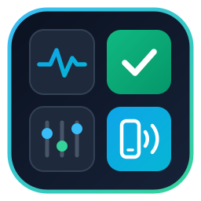

  
  <h1>NexDeck (English Overview)</h1>
  
<strong>Lightweight, open-source, modular platform for Windows 11 hardware monitoring, customizable Stream Deck-style panels, unified notifications, and mobile remote action approval.</strong>

  
<a href="../README.md">Русская версия (Основная)</a>

---

## Overview

NexDeck turns an Android or iOS device into a customizable monitoring and control deck for Windows 11 without cloud dependencies or heavy background runtimes.

- **Minimal Footprint:** Headless **Rust** Core Agent targeting **2–5 MB idle RAM** with zero embedded GUI frameworks.
- **Transport Agnostic:** Wi-Fi / WebSocket for MVP with clean transport abstractions for future USB and Bluetooth channels.
- **Modular & Secure:** Separate pure-Rust Desktop Manager (`apps/desktop`), Flutter Mobile Client (`apps/mobile`), sandboxed WebAssembly plugins, scoped Universal API, and single-use `request_id` remote approvals (never bypassing Windows UAC).

## Documentation

Primary documentation is maintained in Russian:

- [Main README (RU)](../README.md)
- [AI Agent Instructions (`AGENTS.md`, RU)](../AGENTS.md)
- [Project Journal (`JOURNAL.md`, RU)](../JOURNAL.md)
- [Architecture Overview (RU)](architecture/overview.md)
- [Roadmap & Open Questions (RU)](architecture/roadmap.md)
- [Security Policy (RU)](../SECURITY.md)

## License

Licensed under the **Apache License 2.0** — see [LICENSE](../LICENSE).
