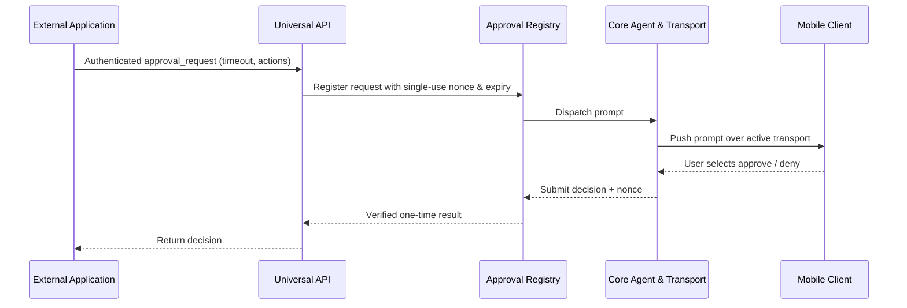

# Universal API Reference (Draft — Stage 0 Contract)

The **Universal API** (`crates/api`) enables local and authorized third-party applications to integrate with NexDeck for notifications, telemetry reads, custom events, plugin interaction, and remote action approvals.

> **Status:** Stage 0 defines the strongly-typed Rust contract and security validation rules. Transport bindings (Local IPC, HTTP, WebSocket) will be implemented in Stage 4 (`TZ.md` §7, §31).

---

## 1. Transports & Priority

- **Local IPC API (Stage 4 MVP):** Windows Named Pipes / local socket for low-overhead local integrations.
- **WebSocket API (Stage 4 MVP):** Bidirectional event and approval callback stream.
- **HTTP API (Stage 4+):** Request/response REST endpoints for simple webhooks and scripts.

---

## 2. Approval Request Example (`TZ.md` §7.1)

```json
{
  "type": "approval_request",
  "application": "MyApplication",
  "title": "Confirm Action",
  "description": "Allow execution of the requested operation?",
  "timeout": 60,
  "actions": ["approve", "deny"]
}
```

See also [examples/approval_request.json](../../examples/approval_request.json).

### Approval Lifecycle



---

## 3. Security Rules (`TZ.md` §7.2)

- Every client must register a unique `ClientIdentity` and authenticate using a revocable token.
- Permissions are deny-by-default (`ReadMetrics`, `SendNotification`, `RequestApproval`, `ReadPlugins`, `ExecuteAllowedAction`).
- Every approval request is bound to a single-use `nonce`, originating `application`, allowed action list, and bounded `timeout_secs` (`1..=3600`).
- Replayed nonces or expired requests are unconditionally rejected.
- Third-party applications never receive unrestricted OS or UAC privileges.
