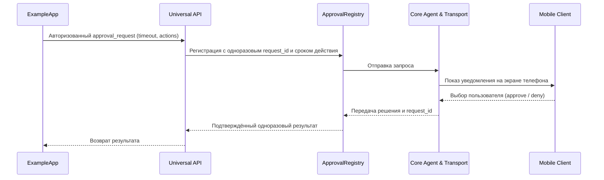

# Universal API (Черновик контрактов Этапа 0)

**Universal API** (`crates/api`) позволяет локальным и сторонним приложениям отправлять уведомления, читать разрешённую телеметрию, создавать события и запрашивать подтверждение действий на мобильном устройстве.

> **Статус:** на Этапе 0 зафиксированы контракты Rust и правила валидации. Сетевые и IPC-транспорты (Local IPC, WebSocket, HTTP) будут реализованы на **Этапе 4**.

---

## 1. Каналы взаимодействия

- **Локальный IPC API (Этап 4, MVP):** Windows Named Pipes / локальный сокет.
- **WebSocket API (Этап 4, MVP):** двунаправленный поток событий и результатов подтверждения на `localhost` (стандартный локальный порт будет зафиксирован на Этапе 4).
- **HTTP API (Этап 4+):** локальные REST-эндпоинты.

---

## 2. Пример запроса подтверждения (`examples/approval_request.json`)

```json
{
  "type": "approval_request",
  "application": "ExampleApp",
  "title": "Подтверждение действия",
  "description": "Разрешить выполнение тестовой операции?",
  "timeout": 60,
  "actions": ["approve", "deny"]
}
```

### Жизненный цикл подтверждения



---

## 3. Правила безопасности

- Каждое приложение регистрируется под уникальным `client_id` и использует отзываемый токен.
- Разрешения выдаются по принципу `deny-by-default` (`ReadMetrics`, `SendNotification`, `RequestApproval`, `InteractPlugins`, `ExecuteAllowedAction`).
- Каждый запрос привязан к одноразовому `request_id`, приложению-источнику, разрешённому списку действий и ограниченному времени ожидания (`1..=3600` секунд).
- Повторное использование `request_id` и просроченные решения отклоняются.
