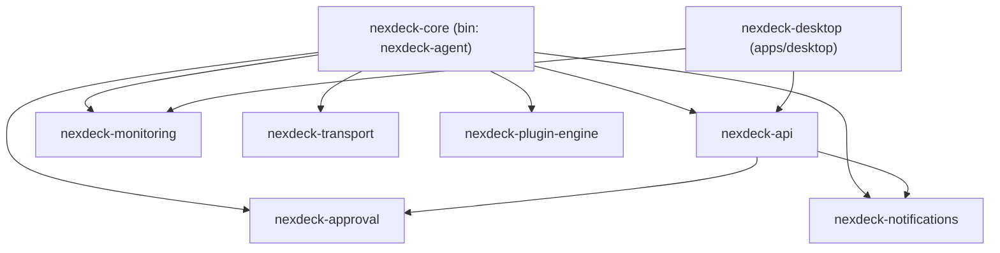

# NexDeck Architecture Overview

NexDeck follows a **decoupled modular architecture** designed to keep the background Windows 11 host agent ultra-lightweight while enabling rich mobile dashboards, external application integrations, and sandboxed plugins.

---

## 1. High-Level System Architecture

---

## 2. Crate & Component Dependency Graph

### Design Rules for Dependencies

1. **Zero UI in Core:** `nexdeck-core` must never depend on GUI frameworks or WebView engines.
2. **Transport Independence:** Domain crates (`monitoring`, `notifications`, `approval`, `api`, `plugin_engine`) must not depend on concrete WebSocket, USB, or Bluetooth implementations — all network/device I/O sits behind `nexdeck-transport` traits.
3. **Separate Desktop Process:** `apps/desktop` (`nexdeck-desktop`) runs as an on-demand GUI process that connects to `nexdeck-agent` over local IPC/API so closing the configurator leaves zero UI memory overhead in the background agent.
4. **Controlled Plugin Surface:** Plugins interact only with capabilities granted in `PluginManifest` and validated by `nexdeck-plugin-engine`.

---

## 3. Component Responsibilities

| Crate / App | Responsibility |
| --- | --- |
| `crates/core` | Headless background agent (`nexdeck-agent`), lifecycle, configuration, pairing state, orchestration loop |
| `crates/transport` | Transport traits (`Transport`), connection state machine, framing envelopes, protocol versioning |
| `crates/monitoring` | Platform-independent telemetry snapshot types (`CPU`, `RAM`, `GPU`, `Disk`, `Network`, `Battery`) and collector traits |
| `crates/notifications` | Notification model, priority levels, filtering rules, bounded sleep/offline retention queue |
| `crates/approval` | Single-use nonce approval state machine, expiration checks, risk levels, decision audit log |
| `crates/api` | Universal API contracts (`UniversalRequest`, `UniversalResponse`), client identities, scoped permissions |
| `crates/plugin_engine` | WASM plugin manifest validation, capability permissions, CPU/memory/time resource quotas |
| `apps/desktop` | Pure-Rust Windows 11 GUI manager (`egui` / `slint`) for pairing, panels, security, and extensions |
| `apps/mobile` | Cross-platform Flutter client (Android & iOS) for live dashboards, controls, notifications, and approvals |

---

## 4. Architectural Decision Records (ADRs)

- [ADR-0001: Rust Core & Modular Cargo Workspace](adr/0001-core-rust-and-workspace.md)
- [ADR-0002: Pure-Rust Desktop Manager UI](adr/0002-desktop-ui-pure-rust.md)
- [ADR-0003: Flutter for Mobile Client](adr/0003-mobile-client-flutter.md)
- [ADR-0004: WebAssembly Primary Plugin Runtime](adr/0004-plugin-engine-wasm.md)
