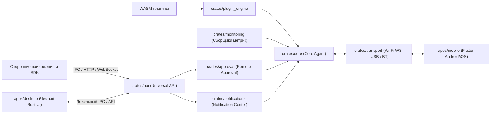
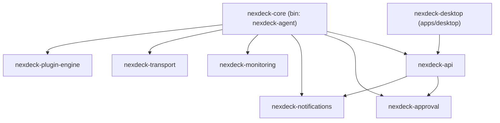

# Архитектура NexDeck

NexDeck строится по **модульной развязанной архитектуре**, чтобы фоновый агент на Windows 11 оставался максимально лёгким, а логика не зависела от конкретного транспорта или GUI.

---

## 1. Общая схема взаимодействия

---

## 2. Зависимости крейтов

### Ключевые архитектурные правила

1. **Никакого GUI в ядре:** `nexdeck-core` не зависит от графических библиотек и WebView.
2. **Независимость от транспорта:** доменные модули работают через абстракцию `Transport` и `Envelope`, не зная о деталях WebSocket, USB или Bluetooth.
3. **Отдельный процесс настройки:** `apps/desktop` подключается к агенту по локальному IPC/API и не занимает память в фоне после закрытия окна.
4. **Контролируемые плагины:** расширения получают доступ только к возможностям, явно описанным в `PluginManifest`.

---

## 3. Назначение компонентов

| Компонент | Зона ответственности |
| --- | --- |
| `crates/core` | Фоновый агент (`nexdeck-agent`), конфигурация, жизненный цикл и координация подсистем |
| `crates/transport` | Трейт `Transport`, машина состояний соединения, фреймы `Envelope` и версионирование протокола |
| `crates/monitoring` | Модели аппаратных метрик (`CPU`, `RAM`, `GPU`, `Disk`, `Network`, `Battery`) и трейт `MetricCollector` |
| `crates/notifications` | События, приоритеты, фильтрация и ограниченная очередь сохранения при сне/разрыве связи |
| `crates/approval` | Реестр подтверждений `ApprovalRegistry`, одноразовый `request_id`, таймауты и уровни риска |
| `crates/api` | Контракты Universal API, политики клиентов `ClientPolicy` и валидация прав |
| `crates/plugin_engine` | Манифест `PluginManifest`, квоты памяти/CPU/времени и модель разрешений WASM |
| `apps/desktop` | GUI-оболочка Windows 11 на чистом Rust (`egui` / `slint`) |
| `apps/mobile` | Мобильный клиент Android / iOS на Flutter |

---

## 4. Архитектурные решения (ADR)

- [ADR-0001: Ядро на Rust и модульный Cargo Workspace](adr/0001-core-rust-and-workspace.md)
- [ADR-0002: Desktop Manager на чистом Rust UI](adr/0002-desktop-ui-pure-rust.md)
- [ADR-0003: Мобильный клиент на Flutter](adr/0003-mobile-client-flutter.md)
- [ADR-0004: WebAssembly как основной рантайм плагинов](adr/0004-plugin-engine-wasm.md)
